# Evidencias del primer avance funcional de MEGA

Capturas de la aplicación ejecutada el 11 de noviembre de 2026, con datos ficticios. Son evidencias de implementación y de un recorrido automatizado. No constituyen pruebas de aceptación con personal del negocio. El registro del recorrido está en [resultado del navegador](evidencias/resultado_navegador.json).

## Figura 1 Acceso local

**S01 / CU13 / RF06.** La pantalla permite ingresar una cuenta y contraseña. El recorrido verificó el rechazo de credenciales incorrectas antes de iniciar sesión con Cajero. Las cuentas mostradas pertenecen a la demostración.

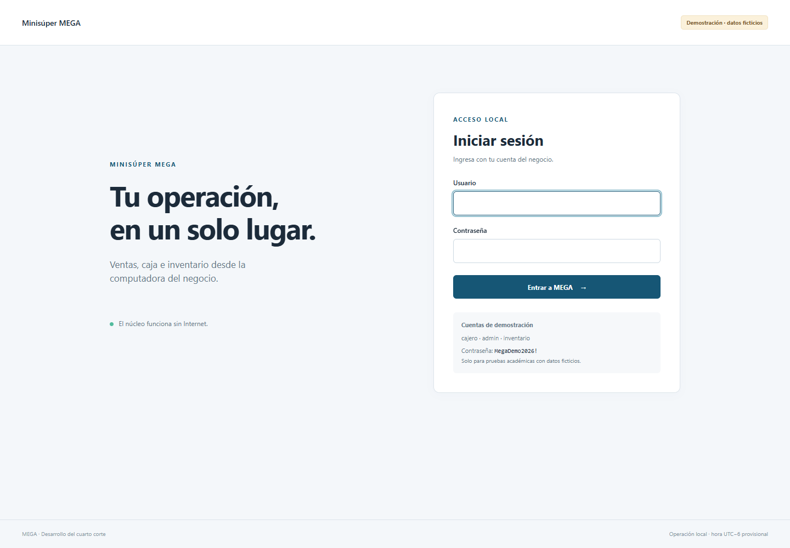

## Figura 2 Caja abierta con fondo real

**S25 / CU03 / RF05.** Se abre un turno propio con C$480 frente al fondo habitual de C$500, conservando el motivo de la diferencia. El fondo real determina el esperado posterior.

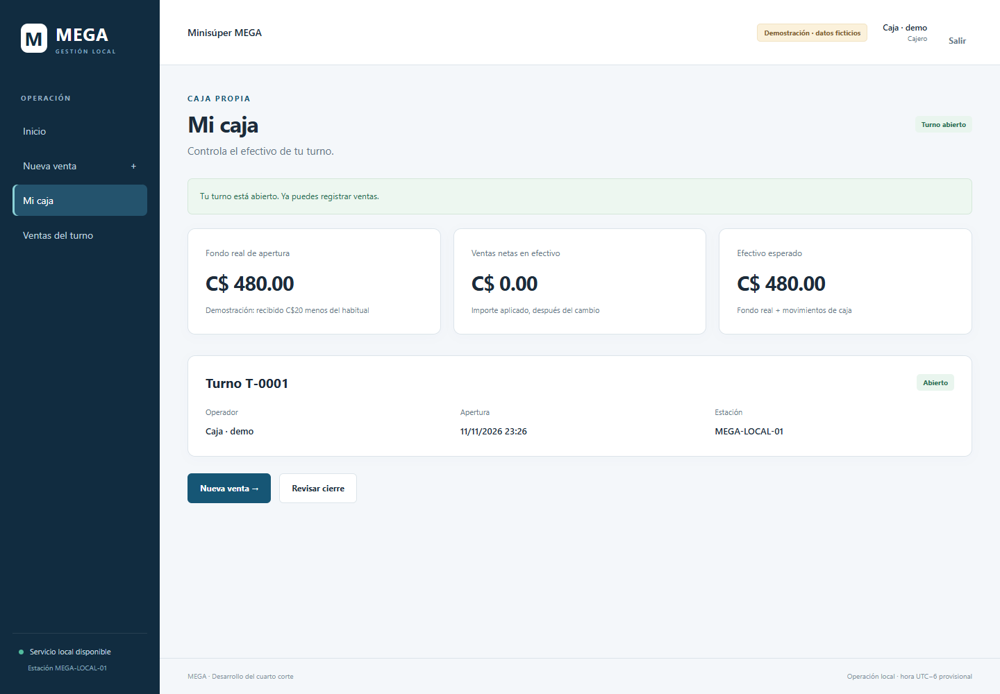

## Figura 3 Compra en preparación

**S23 / CU01 / RF04.** Se agregan 2 lb de arroz a C$24 y una leche a C$38. La cotización del servidor devuelve C$86. Preparar la compra todavía no crea una venta ni descuenta existencias.

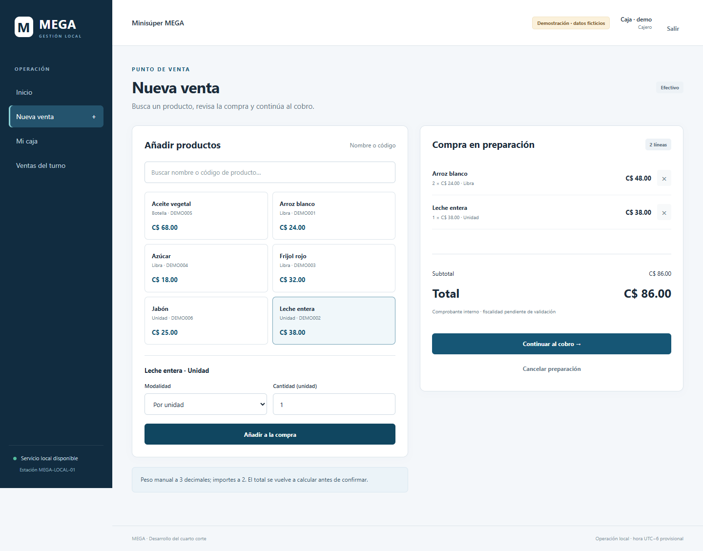

## Figura 4 Pago insuficiente

**S24 / CU01 / RF04.** Para un total de C$86 se ingresan C$80. La interfaz informa el faltante y deshabilita confirmar. La prueba de servidor complementaria acredita que tampoco es posible eludir esta validación enviando la solicitud directamente.

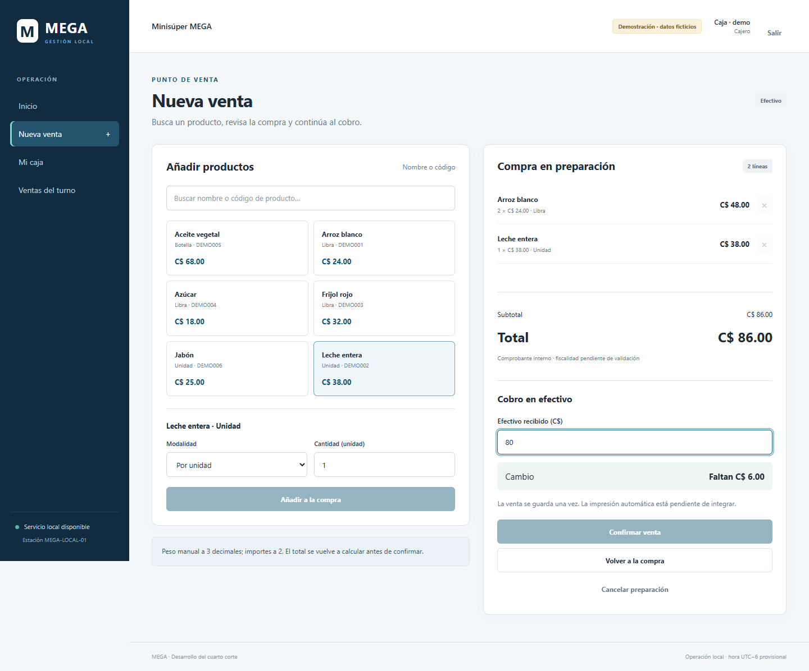

## Figura 5 Cobro en efectivo

**S24 / CU01 / RF04.** Con C$100 recibidos, la pantalla muestra C$14 de cambio. El usuario revisa el total antes de confirmar.

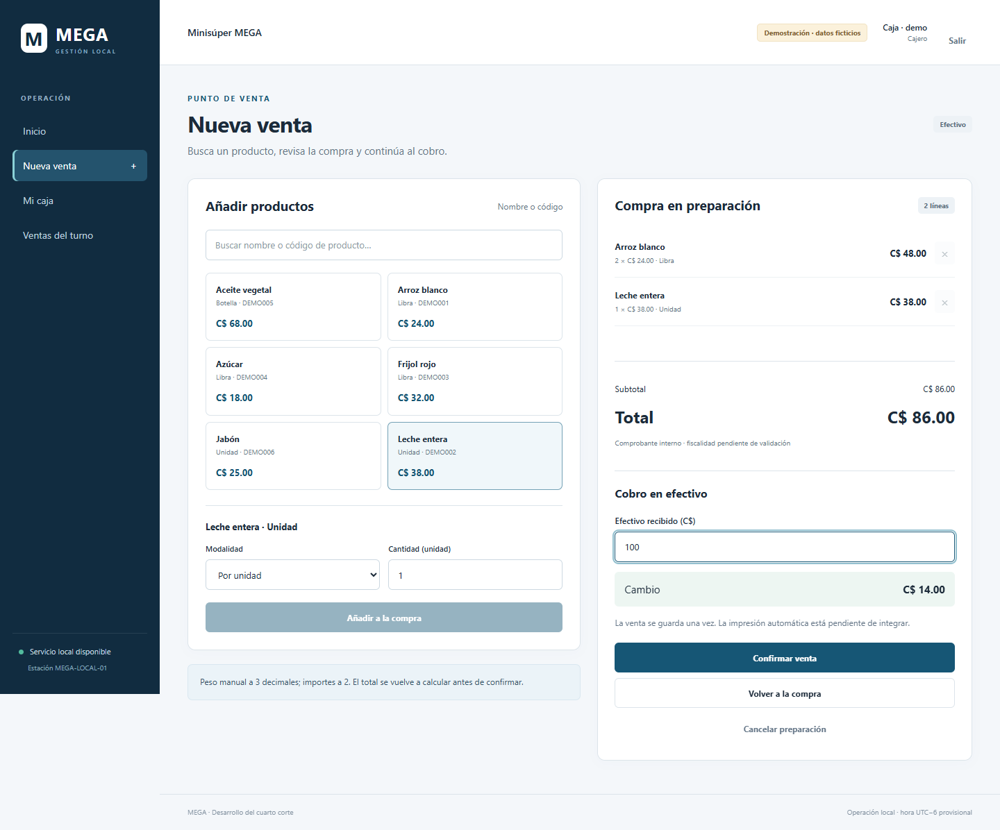

## Figura 6 Comprobante de venta confirmada

**S17 / CU01 / RF04.** La venta conserva folio, operador, descripción de las líneas, precios, total, recibido y cambio. Se comprueba el hash del snapshot antes de mostrarlo. La solicitud de impresión permanece Pendiente porque el agente físico sigue en desarrollo.

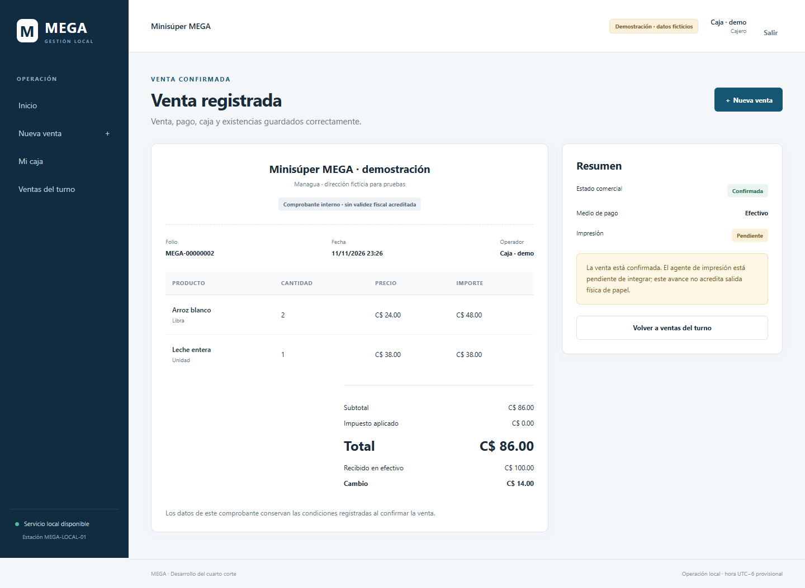

## Figura 7 Caja después de la venta

**S25 / CU10 / RF05.** La caja muestra C$480 de fondo real más C$86 aplicados: esperado C$566. El ingreso de caja es el neto de la venta y no los C$100 brutos recibidos.

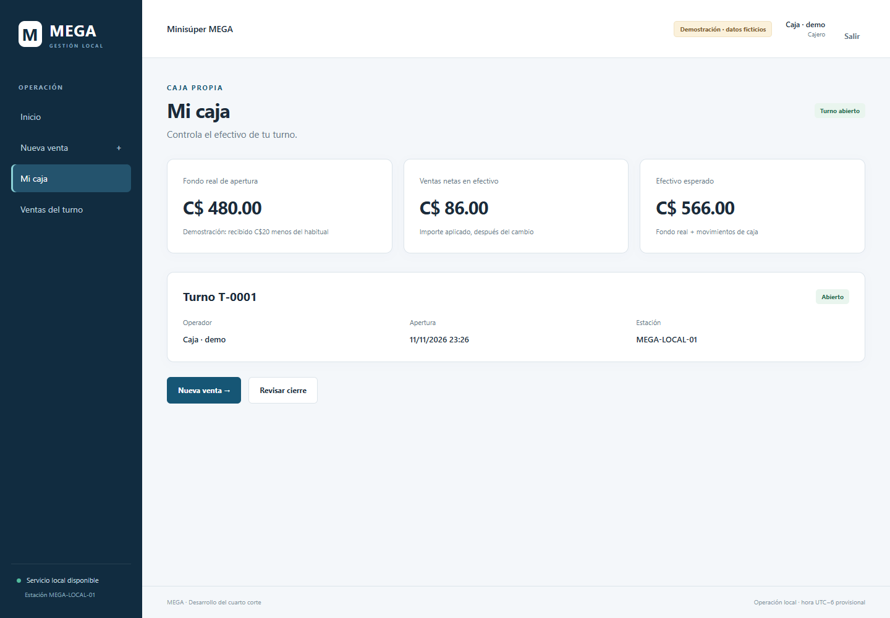

## Figura 8 Revisión del cierre

**S25 / CU10 / RF05.** Se cuentan C$560 y se explica una diferencia de −C$6. Después de esta captura, el recorrido confirma el cierre y verifica el mensaje de cierre registrado. Las pruebas de integración comprueban la persistencia de esperado/contado/diferencia.

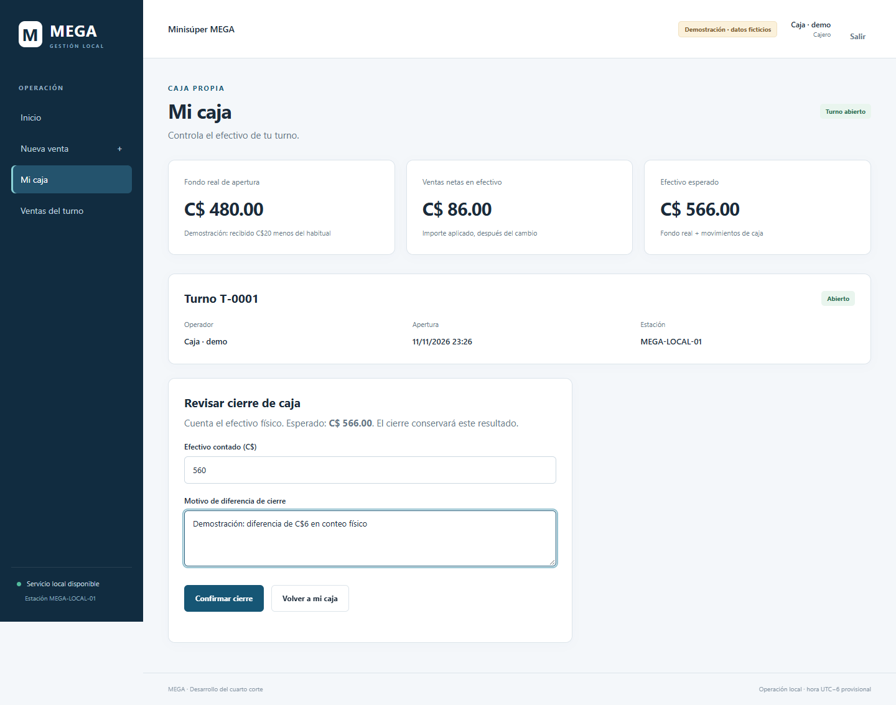

## Figura 9 Existencias para Inventario

**S08 / CU06 / RF03 y RF06.** La cuenta Inventario ve 48 lb de arroz y 29 unidades de leche después de la venta. Su menú no ofrece caja o venta y el servidor rechaza el acceso directo a esas funciones.

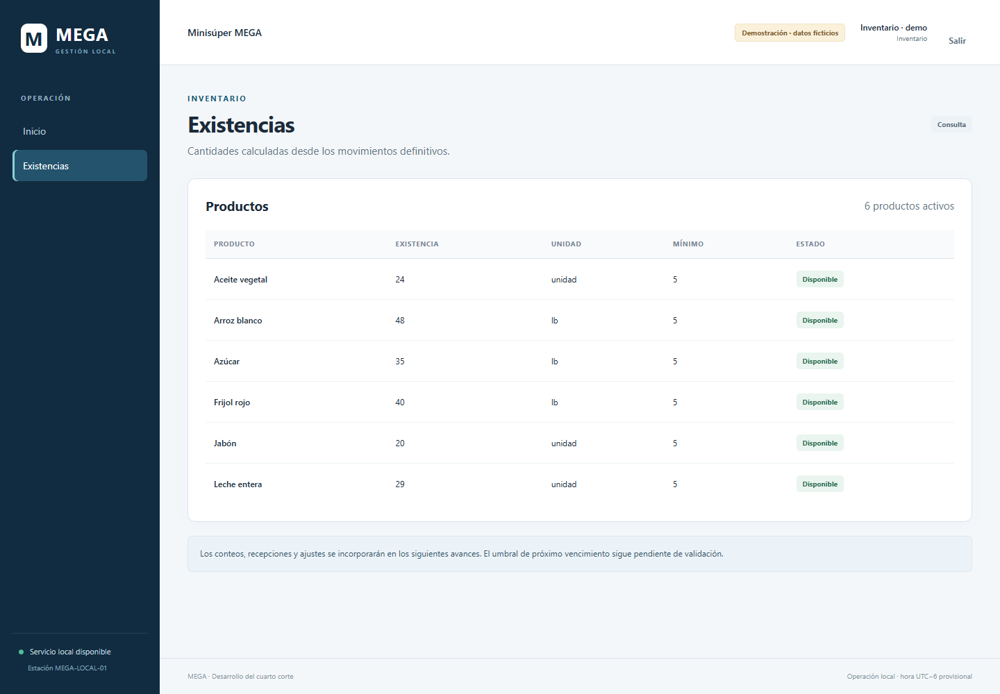

## Figura 10 Consulta en pantalla estrecha

**S08 / RF03.** La interfaz adapta navegación y contenido a 390 px. La tabla permite desplazamiento horizontal en su propio contenedor. Se verifica que la página completa no desborde el ancho del navegador.

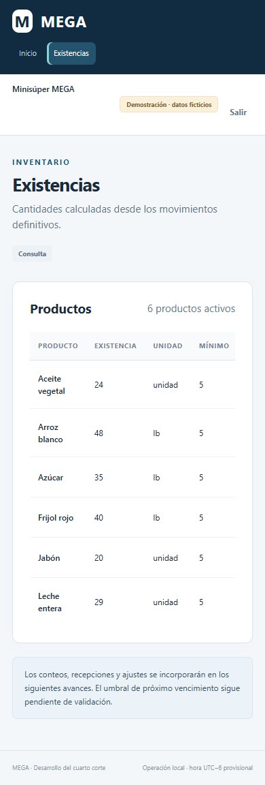

## Figura 11 Recuperación tras perder la respuesta de confirmación

**S24 / CU01 / RF04.** La prueba intercepta la respuesta después de que el servidor guardó una venta de un jabón por C$25. Se recarga la pestaña y se conserva la intención original. Recuperar devuelve el comprobante de la misma venta; se verifica una única venta en el turno y caja C$525 con fondo C$500. La pestaña impide cambiar el cobro mientras se recupera el resultado. El [registro de recuperación](evidencias/resultado_recuperacion.json) conserva las comprobaciones.

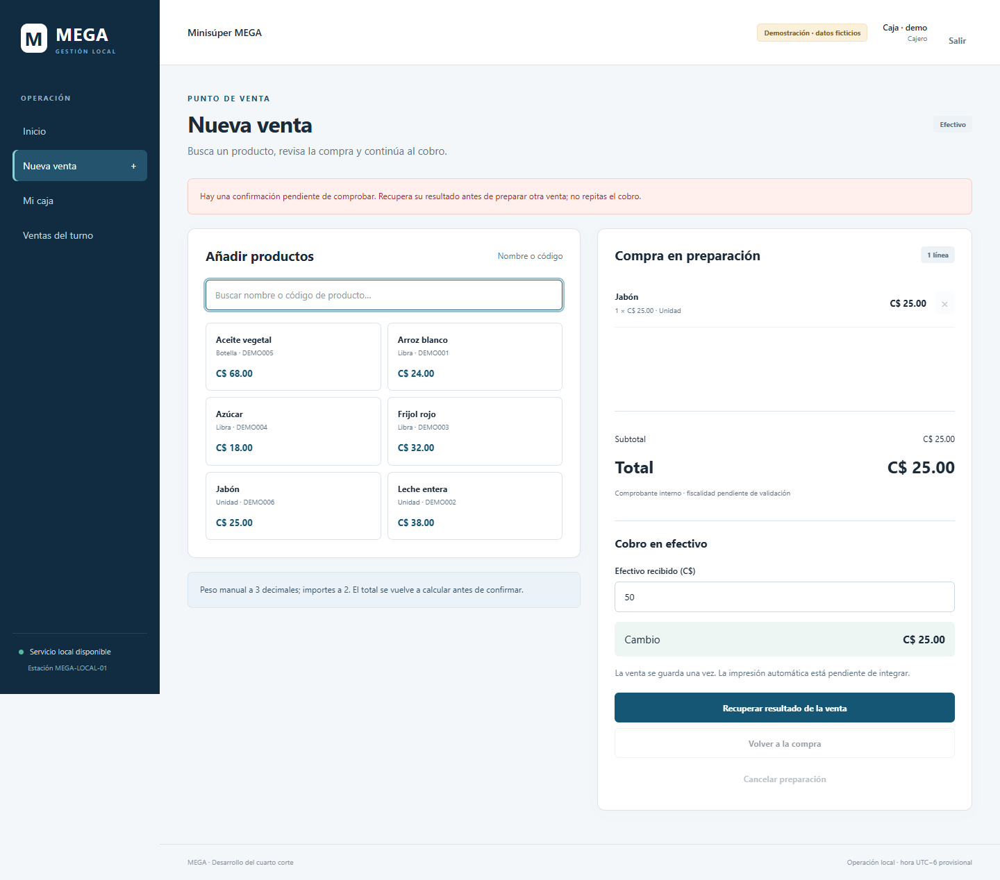

Fuente de todas las figuras: aplicación MEGA del avance 01, capturada mediante prueba automatizada; datos de demostración.
